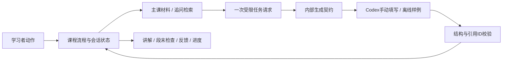

# 模型无关教学框架 v0

日期：2026-10-23。交付为可运行的学习流程内核、内部模型契约、离线验证工具和设计说明；尚无最终用户界面。

## 当前交付目标与用户约束

- “8B”仅表示面向能力受限的小模型做准备，不指定真实型号，也不作为已经验证的运行条件。
- 保留内部生成能力的适配契约，不实现厂商API、服务URL、密钥配置或模型下载。
- 学习者侧只需关注学习目标、讲解、提问、理解检查和进度。将来界面不展示模型选择、API地址、密钥或RAG参数等开发配置。
- 本阶段以Codex开发、读取结构化请求、手动填写响应及离线回放来验证框架。开发命令和JSON文件是验证工具，不是学习者的产品使用流程。
- 不把Codex或固定样例的表现当成8B模型表现，也不把合成作答当作真实用户的学习结果。

## 产品学习闭环

选择一个小目标 → 连贯讲解 → 段末统一确认 → 作答反馈 → 针对性补充或收束 → 用户选择下一步。

用户可以主动澄清、暂存衍生问题、跳过理解检查或暂停。程序管理主线和阶段，不让一次生成任意更改学习目标、提前宣称完成或自动展开全部支线。

## 模块与当前状态

| 模块 | 当前实现 | 位置 |
| --- | --- | --- |
| 课程单元 | 3个教学单元初稿，每个含目标、教材ID、段末问题和参考要点 | curriculum/units.json |
| 知识材料 | 11张教学初稿卡、6个官方来源记录 | kb/ |
| 检索 | BM25与概念增强对照；主课按教材ID加载，澄清问题使用检索 | tutor_rag/engine.py、workflow.py |
| 学习流程 | 阶段约束、段末检查、补充解释、澄清后返回、跳过、暂存、暂停恢复与下一单元选择 | tutor_rag/workflow.py |
| 内部生成契约 | GenerationPort协议及request/apply校验；未实现具体服务 | tutor_rag/workflow.py |
| 会话记录 | JSON状态、事件、作答历史、是否接受额外帮助、未解决问题；单文件原子替换保存 | workflow.py |
| 开发验证 | 固定样例回放、Codex手动契约走查、自动化测试 | examples/、reports/framework-v0/、tests/ |
| 用户界面 | 已定义学习流程，尚未实现屏幕、按钮及真实交互 | 本文与learning-flow.md |
| 生产运行能力 | 尚无多用户数据库、并发控制、实际服务适配或上线部署 | 不在本轮交付范围 |



这里没有实际网络模型连接。将来如需接入具体模型，只在内部契约处增加适配器，保留应用对流程的控制。

## 阶段和权限

| 阶段 | 允许的主要动作 | 后续 |
| --- | --- | --- |
| ready | 准备explain请求 | 合法讲解响应后到checkpoint_ready |
| checkpoint_ready | 显示段末题、主动澄清、跳过 | 显示题后到awaiting_answer |
| awaiting_answer | 提交答案、主动澄清、跳过 | 作答后到assessment_ready |
| assessment_ready | 准备assess请求 | 待补充、待复核或待总结 |
| remediation_ready | 准备remediate请求或主动澄清 | 补充后回checkpoint_ready |
| review_required | 记录判定不确定，允许主动澄清、补充回答或跳过检查 | 不自动通过；补充后重新反馈 |
| summary_ready | 准备summarize请求或主动澄清 | 合法总结响应后到completed |
| completed | 显式选择下一单元 | 新目标开始，保留历史与待处理问题 |
| paused | 恢复 | 返回暂停前阶段，保留尚未应用的请求 |

准备请求不会直接推进学习阶段；校验响应后才转移。请求处理中不能重复发起另一个请求或提前出检查题。可以取消旧请求再重试，旧响应不能应用到新请求。

衍生问题暂存不改变目标。主线完成后也保留未解决问题，不自动把它们标记为已学会。

## 内部输入输出契约

一次请求只承担explain、clarify、assess、remediate、summarize中的一种职责。

请求包含request_id、session_id、当前目标、材料、必要的当前作答与阶段约束。只在assess请求中放入当前检查题和参考要点，不把整套评分材料放入检索库或普通讲解请求。

响应只允许request_id、kind、text、citations、status，以及评分阶段的verdict。额外的切课、改目标字段会被拒绝。

- status为grounded或insufficient_evidence。grounded仍是填写方的声明；程序只检查引用是否来自本次材料，不证明事实依据充分。
- verdict只允许needs_support、evidence_recorded、uncertain。它是待验证的反馈，不等于独立掌握。
- 回答需有本次请求ID、正确任务种类、允许的引用和限定长度；非法响应保留原状态，可以取消并重试。
- 资料不足时不推进阶段；不允许以空材料提交有依据的教学响应。
- 当前材料预算为3200字符、输出上限为1200字符。材料预算只计材料项，不等于整个请求长度，也不是Token预算；这些是初始设计约束，不是8B模型已能承受的结论。

## 准备小模型接入所做的工作

应用承担课程顺序、单目标、任务拆分、材料选择、长状态保存和输出校验；一次生成只处理短任务。每轮只提供需要的材料与近期作答，不把整个事件历史全部交给生成方。

这些措施旨在缩小生成职责与上下文范围。实际小模型能否讲对、按格式输出、正确反馈及保持主线仍需真实测试，本轮不以参数量推定能力。

## Codex离线验证怎么做

### 固定样例回放

```powershell
python -m tutor_rag.workflow demo --out output/framework-demo.json
```

回放文件来自examples/framework_replay.json，是Codex编写的合成样例。路径包含首次答错、补充、再答、总结、支线暂存及暂停恢复，验证流程转移而非模型生成。

### Codex手动契约走查

```powershell
python -m tutor_rag.workflow start probability_vs_regression output/session.json
python -m tutor_rag.workflow request output/session.json explain output/request.json
```

让Codex读取request.json，依据其中的材料按output_contract写出response.json，然后由开发验证命令应用：

```powershell
python -m tutor_rag.workflow apply output/session.json output/response.json
python -m tutor_rag.workflow event output/session.json checkpoint
python -m tutor_rag.workflow event output/session.json answer --text "这里填写试用回答"
python -m tutor_rag.workflow request output/session.json assess output/assessment-request.json
```

后续同样读取请求、写响应、应用；需要补充时准备remediate，待收束时准备summarize。下一单元由用户动作选择：

```powershell
python -m tutor_rag.workflow event output/session.json defer --text "以后再了解阈值"
python -m tutor_rag.workflow event output/session.json pause
python -m tutor_rag.workflow event output/session.json resume
python -m tutor_rag.workflow event output/session.json cancel_request
python -m tutor_rag.workflow next output/session.json classification_vs_clustering
```

各命令只在合适阶段生效，不应机械逐行执行以上不同阶段示例。cancel_request只撤销内部待应用状态，不是向某个服务发送取消请求。此处文件填充也不调用任何Codex API。

## 验证与证据边界

已完成25项自动化测试、固定样例回放和一次Codex手动填充契约走查。结果见[验证报告](../reports/framework-v0/verification.md)。

程序验证的是阶段、格式、引用ID、重试与状态保持。讲解是否有跳步、引用是否真正支持结论、反馈是否准确和实际学习效果仍需内容审阅与真实试用。

额外提示后的作答与未接受额外提示的作答分别记录；这里的“无额外提示”也不直接等于独立迁移能力。跳过检查会明确记为not_checked；完成单元只表示流程结束。

## 下一轮验收

先在当前对话中以一个教学单元做真实学习者走查：由用户实际回答，记录卡点与教学节奏，再修正内容和完整PRD。界面实现及真实模型测试均为后续明确范围后推进的工作，不作为本轮框架验证的前提。
